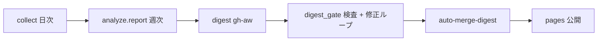

# AI Trend Radar

過去 1 週間に AI・ローカル LLM 界隈で新しく出たもの(製品・モデル・リリース・論文・ハード)と、その**共通する背景**を、公式の一次情報で確認して日本語で整理する週次ダイジェストです。収集からサイト公開まで人手なしで回ります(AI の下書きは、決定的な検査を通ったものだけが公開されます)。

- サイト: GitHub Pages(`https://aktsmm.github.io/ai-trend-radar/`、公開後)
- 1 キーワードあたり: ダイジェスト文 + 図解 1 枚。週の全体像を 1 枚にまとめた図、今週のテーマ(共通の背景の見立て)、公式発表の一覧もあります。絞り込んだ項目(不要なものはチェックを外す)の 2 枚ブリーフを、PDF / PowerPoint にまとめてダウンロードできます。
- データ: 静的 JSON API(`api/v1/index.json`、仕様は [docs/api.md](docs/api.md))と Atom フィード。

## 仕組み(1 分でわかる図)



| いつ | 何が動くか |
| --- | --- |
| 毎日 05:00 JST | `radar`: 各ソースを収集し、日次スナップショットを Git に保存 |
| 月曜 00:30 JST | `radar`: 週次レポート → `digest` を起動 |
| 木曜 00:30 JST | `radar`: 中間更新(新しい候補だけを追加。掲載済みは固定) |
| 週次レポートの後 | `digest`: 未処理の候補を調べて JSON を作り、検査に落ちたら直して再検査(最大 5 回)→ PR |
| 3 時間ごと / digest 完了時 | `auto-merge-digest`: 信頼できるコードで検証し、通れば自動マージ → `pages` |
| 6 時間ごと | `watchdog`: 止まった実行の停止、pages の再試行、9 日成功なしで Issue |

## 詳細はここ

| 知りたいこと | ドキュメント |
| --- | --- |
| 設計・データ層・検査・サイト・権限・収集元 | [docs/design.md](docs/design.md) |
| 止まったとき・誤情報が載ったとき | [docs/runbook.md](docs/runbook.md) |
| JSON API・ダウンロードの URL | [docs/api.md](docs/api.md) |
| 収集元の一覧と制約 | [docs/sources.md](docs/sources.md) |
| データの形(JSON Schema) | [schema/trend.schema.json](schema/trend.schema.json) |

## 使い方(ローカル)

```powershell
pip install -r requirements.txt
python -m playwright install chromium
python -m unittest discover -s tests          # テスト
python -m render.build_all --offline           # apply → ゲート → 検証 → PNG/PDF/PPTX/API(site/ に出力)
python -m analyze.digest_gate --week 2026-W42  # 生成物の検査だけ
```

収集とレポートの再生成は `python -m collect.run` → `python -m analyze.report`(通常は Actions が実行します)。

## ライセンス

コードは MIT([LICENSE](LICENSE))。掲載内容は各社・各作者の公開情報の要約で、出典と免責は [NOTICE](NOTICE) にあります。AI による下書きを含むため誤りがありえます。気づいた点は Issue でお知らせください。
