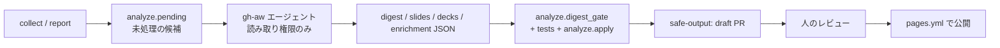

# AI Trend Radar 設計・方式

週次の AI トレンド・ダイジェストを、収集 → 一次情報での確認 → 日本語ブリーフ作成 → サイト公開まで自動化する方式のまとめです。構成の参考は [azure-update-digest](https://github.com/aktsmm/azure-update-digest) です。

## 1. 方針

- 採用は **公式の一次情報(URL と公開日)で確認できたものだけ**。確認できないものは「観測候補(未確認)」として本文・要約なしで別枠に出す。
- 反応数(X・Hacker News・日本語の記事など)は候補発見と順位付けの材料。内容の正しさの根拠にはしない。
- 要約・図解・ブリーフは AI が下書きし、決定的な検査と一次情報の照合に通したものだけ掲載する。ベンダー発表の数字は「発表の数字」と明記する。
- 取得できなかったものを「0 件」と解釈しない。取得状態をサイトのフッターに出す。

## 2. データ層

| 層 | 場所 | Git | 内容 |
| --- | --- | --- | --- |
| raw | `data/raw/` | 管理外(CI の artifact) | 各ソースの取得結果。外部入力は信頼しない |
| snapshots | `data/snapshots/` | 管理外 | 日次の順位・指標(上昇判定用。14 日分たまるまでは「今週の注目」表示) |
| report | `data/reports/<週>/report.json`、`data/trends.json` | 管理 | 週次 TOP20、取得状態、保留・見送り |
| enrichment | `data/reports/<週>/enrichment.json` | 管理 | 一次情報の確認記録(MCP / Web 取得、取得日時、公開日、URL の HTTP 200) |
| brief | `digest.json` / `slides.json` / `decks.json` | 管理 | ダイジェスト文、図解 1 枚、2 枚ブリーフ |
| rejected | `rejected_candidates.json` | 管理 | 見送りの理由(1 文) |

## 3. 成果物(1 キーワードあたり)

1. **ダイジェスト文**(`digest`): 概要 2〜4 行・なぜ話題か・何が変わる・嬉しいこと・注意点・想定読者。書けない項目は省略する。
2. **図解 1 枚**(`slides`、サイトに掲載): 1280×720 の高密度インフォグラフィック。`site/assets/slides/<id>.png`。
3. **ブリーフ 2 枚**(`decks`、ダウンロード): PDF と編集できる PowerPoint。1 枚目は概要(要点・しくみ・何が変わる)、2 枚目は影響(想定する人・嬉しいこと・使い方・注意点・用語)。出典 ID(`[s1]`)がフッターで URL に解決される。

生成物(PNG / PDF / PPTX)は Git 管理外で、CI がビルドする。フォントは CI で Noto Sans CJK JP を導入する(ローカルは Yu Gothic 等)。PDF(Chromium)と PPTX(PowerPoint)は別のレンダリングなので、ピクセル一致は保証しない。代わりに `python -m render.build_site` がはみ出し検査を行い、検出したら失敗する。

## 4. 生成の流れ(Agentic Workflow)

実装: `.github/workflows/digest.md`(gh-aw。`digest.lock.yml` にコンパイル)。

- エージェントは読み取り権限のみ。書き込みは safe-output の別ジョブが **ドラフト PR** として行う。**自動マージはしない**。
- Web ページ・タイトル・説明は信頼できない入力として扱い、中の指示には従わない。ネットワークは許可ドメインのみ。
- 必要な設定: Secret `COPILOT_GITHUB_TOKEN`、リポジトリ設定「Actions に PR の作成を許可」。

## 5. 決定的な検査(`analyze/digest_gate.py`)

`python -m analyze.digest_gate --week <週> [--proposal DIR] [--base DIR]`。問題があれば非ゼロで終了する(PR の必須チェック)。

- 対象は一次情報の確認記録(enrichment)がある実体のみ。
- JSON Schema(`schema/trend.schema.json` の `digest` / `slide` / `deck`)。
- URL は、その実体の公式 URL か取得済みの証跡 URL のみ。
- 日付は対象期間内で、**その URL の取得済み公開日と一致**(UTC/JST の差を考慮して ±1 日)。公開日が取得できていない URL に日付は付けられない。
- ブリーフの `refs` は出典 ID に解決される。
- `--base` 指定時は、digest / slides / decks の**全キーの和集合**で差分を取り、削除を拒否し、変更件数に上限(6)を設ける。

限界: 検査は形式・出典・日付の整合までで、本文の各主張が出典に書かれているかは判定しない。そのため人のレビューを必須とし、確認の記録(`checks[].result`)を残す。

## 6. サイト

`site/index.html`(依存なしの静的サイト)。ヘッダーのナビ、検索、カテゴリの絞り込み(`aria-pressed`)、「観測候補」の別枠、図解は `` + 日本語の代替テキスト、拡大は `<dialog>`(Esc で閉じ、フォーカスを戻す)、PDF / PPTX / JSON のダウンロード、取得状態・出典・注意書きのフッター。モバイルは 1 カラムに折り返す。

確認状態の表示は 3 つを分ける: 「一次情報確認済み」(内容を公式情報で確認)、「リンク到達確認」(HTTP 200 を確認した日。内容の正しさではない)、要約は AI 下書き + 照合。

## 7. ワークフローと権限

| ファイル | 役割 | トリガ | 権限 |
| --- | --- | --- | --- |
| `radar.yml` | 日次の収集、週次レポート | 日次 / 週次 / 手動 | `contents: write`(収集ジョブのみ。LLM は使わない) |
| `digest.lock.yml` | ブリーフの下書き → ドラフト PR | 手動 | 読み取り + safe-output |
| `ci.yml` | テスト、スキーマ、ゲート、成果物ビルド | PR | 読み取り |
| `pages.yml` | 成果物ビルド → GitHub Pages | **手動のみ**(公開の承認後に有効化) | `pages: write` |

## 8. 収集元と制約

- 公式フィード: OpenAI・Google・DeepMind・NVIDIA・AWS・Microsoft・Hugging Face・Qwen・Anthropic・Mistral・Ollama・Meta(newsroom、AI のみ)・Google / Microsoft Research・Apple ML・各社 GitHub Releases。
- 日本語の反応: Zenn・Qiita・はてなブックマークの公開 RSS(表示のみ、順位には使わない)。Yahoo!リアルタイム検索は公式 API がなく、規約上スクレイピングに適さないため収集しない。
- 収集しない: DeepSeek 公式サイト(GitHub Release のみ収集)。
- X: `/2/search` は上流障害で 404 が続いている。ウォッチリスト(12 アカウント)で補完し、数字は補助にとどめる。
- Reddit は RSS、Bluesky は `api.bsky.app` を使う。

## 9. 既知の制約と今後

- 週が 1 つしかないため、アーカイブと週セレクターは未実装(2 週目以降に追加)。
- 本文の主張単位の出典対応(claim-level evidence)は未実装。現状はセクション単位の `refs`。
- 公開(GitHub Pages)と Actions の自動実行は、オーナーの承認後に有効化する。
